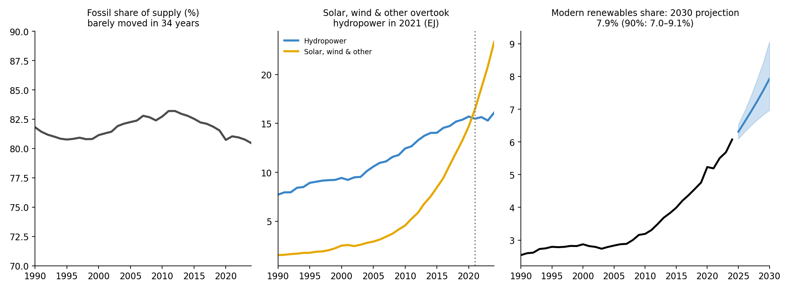

# Global Energy Transition Analysis

How fast is the world's energy mix actually changing, and where could the **renewable share of supply** be in 2030?
An independent project using the IEA's World Energy Balances (total energy supply by source, World, 1990–2024), built in Python (pandas, NumPy, SciPy, PyMC, ArviZ, Matplotlib).



## Headline findings

| Finding | Value |
|---|---|
| World total energy supply, 1990 → 2024 | 364 → 650 EJ |
| Fossil share of supply, 1990 → 2024 | 81.8% → 80.5% |
| Modern renewables share (hydro + solar, wind & other) | 2.5% → 6.1% |
| All renewables share (adds biofuels & waste) | 12.1% → 14.8% |
| Solar, wind & other renewables: CAGR 1990–2024 (2010–2024) | 8.3% (12.4%) |
| Share of all *added* supply 1990→2024 from solar, wind & other | 7.6% (coal + gas supplied 57.9%) |
| Solar, wind & other permanently overtook hydropower | **2021** |
| **2030 projection**, modern renewables (median, 90% interval) | **7.9%** (7.0–9.1%) |
| **2030 projection**, all renewables | **16.2%** (14.7–17.9%) |

**Takeaway.** Solar, wind and other renewables are the fastest-growing source by far, but from a small base: in absolute terms the world added far more coal and gas than solar, wind and other renewables, so the fossil share has moved only about 1.3 percentage points in 34 years.

## Method in brief
1. **Clean & validate** (`01`): the raw file has metadata lines above the header and an unnamed year column; units are TJ, converted to EJ. Checks: contiguous years, no missing or non-positive values; total supply dips only in 2009 and 2020.
2. **Shares & CAGR** (`02`): shares of fossil, renewable, modern-renewable and low-carbon sources; CAGR over four windows (using 34 intervals for 1990→2024); growth *rate* compared with *absolute* growth; crossover detection (first year after which A stays above B).
3. **Bayesian projection** (`03`): the logit of each share (keeps projections inside 0–100%) is modelled with a **Bayesian smooth local trend** (state-space) model whose slope is allowed to drift. States are integrated out with a Kalman filter in PyMC. Compared against a random-walk-with-drift baseline (M0) and a linear-trend + AR(1) model (M1).
4. **Summary** (`04`): key findings table and figure computed from saved results.

## How the model was checked
- **Sampler diagnostics:** all six final fits have R-hat ≤ 1.004, ESS ≥ 839 and zero divergences (`results/sampler_diagnostics.csv`). An earlier sensitivity fit had divergences; it was re-run with tighter settings.
- **Prior predictive check:** priors are deliberately diffuse (90% prior range for the 2030 share spans ~0–49%), so the result is data-driven.
- **Posterior checks:** standardised one-step-ahead errors have mean ≈ 0, SD ≈ 0.96 and lag-1 autocorrelation ≈ 0.
- **Implementation cross-check:** the Kalman version agrees with an explicit latent-state version (2030 median 7.92% in both).
- **Rolling-origin backtest** (origins 2012, 2014, 2016, 2018; up to 6 years ahead):

| Series | Model | MAE (pp) | 90% interval coverage |
|---|---|---|---|
| Modern renewables | M0 random walk + drift | 0.46 | 17% |
| | M1 linear trend + AR(1) | 0.54 | 17% |
| | **M2 smooth local trend** | **0.09** | **96%** |
| All renewables | M0 random walk + drift | 0.84 | 17% |
| | M1 linear trend + AR(1) | 0.97 | 17% |
| | **M2 smooth local trend** | **0.24** | **96%** |

## Limitations
- **A statistical extrapolation, not a policy forecast.** It assumes the process behind 1990–2024 continues; policy, prices and supply shocks can break it. It is not comparable to scenario-based outlooks.
- **Backtest is small:** four origins, overlapping horizons (24 non-independent forecasts per model), and the window includes the 2020 dip. Shares are smooth aggregates, which flatters trend models in the short run.
- **Model uncertainty:** different reasonable models give different 2030 values (`results/model_sensitivity_2030.csv`); no single interval captures that fully.
- **"Solar, wind and other renewables"** is one IEA category (it also includes geothermal, solar thermal, etc.), so technologies cannot be separated.
- **Biofuels & waste includes traditional biomass**, hence modern renewables are reported separately.
- **Accounting method:** shares depend on how the IEA counts non-combustible sources and are not comparable to shares published under a different method.
- **Global aggregate** hides very different regional paths; modelling by region is the natural next step. Prior sensitivity was not run.

## Repository layout
```
data/raw/        IEA extract (CC BY 4.0) + README   data/processed/  cleaned wide and long tables
src/             energy.py (load, validate, shares, CAGR), model.py (PyMC models, forecasting)
scripts/         run_models.py, run_backtest.py, crosscheck_latent.py (heavy MCMC; save to results/)
notebooks/       01 cleaning · 02 shares & CAGR · 03 Bayesian projection · 04 summary figures
results/         tables, saved posteriors (.nc), projections    figures/   PNGs used above
```

## Reproduce
```bash
pip install -r requirements.txt
python scripts/run_models.py        # ~3 min on one CPU core
python scripts/run_backtest.py      # ~8 min
python scripts/crosscheck_latent.py # ~4 min
jupyter nbconvert --to notebook --execute --inplace notebooks/0*.ipynb
```
Notebooks 01 and 02 do not depend on the scripts; 03 and 04 need the scripts' outputs (already included in `results/`).

## Data and licence
Data: IEA World Energy Balances, https://www.iea.org/data-and-statistics/data-product/world-energy-statistics-balances, licensed CC BY 4.0. Code: MIT.
